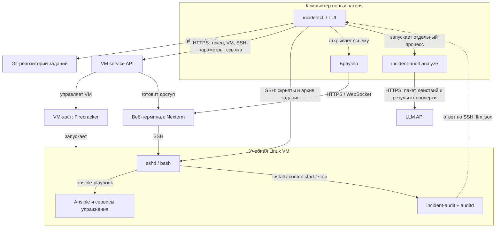

# incidentctl

`incidentctl` — CLI/TUI для тренировки устранения инцидентов в учебной VM.
Он готовит окружение, вносит неисправность, записывает действия и проверяет решение.
Пошаговый запуск: [интеграция audit-agent](docs/audit-integration.md).

Готовое приложение: скачайте архив для своей ОС из
[GitHub Releases](https://github.com/IncidentSim/tui-ansible-runner/releases)
и следуйте **пользовательскому README внутри архива**.
Его исходник находится в [distribution/README.md](distribution/README.md).
Ниже описаны архитектура и сборка из исходников.

## Как это устроено



| Где | Что выполняется |
| --- | --- |
| Компьютер пользователя | TUI запускает `git`, `ssh` и локальный `incident-audit analyze`. Здесь находятся конфигурация, ключ LLM и отчёты. |
| Серверная сторона | VM API проверяет токен и управляет VM через Firecracker на VM-хосте. Выдаёт SSH-параметры и ссылку веб-терминала. |
| Учебная VM | По SSH выполняются `bash`, `apt-get`, `tar`, `incident-audit install/control` и `ansible-playbook --inventory 'localhost,' --connection local …`. **`localhost` здесь — сама VM.** Здесь же работают nginx, Docker и другие сервисы упражнения. |
| Сервер Nexterm | Соединяет браузер с SSH в VM. Введённые пользователем команды выполняются внутри учебной VM. |

Цикл работы:

1. TUI загружает задания из Git, проверяет токен через API и использует сохранённую VM либо создаёт новую.
2. По SSH устанавливает пакеты и агент, загружает задание. **Внутри VM** запускает `infra`, затем `incident` и `verification`: ожидаемая ошибка проверки подтверждает, что инцидент воспроизведён.
3. Включает запись audit-agent и открывает веб-терминал. Пользователь исправляет сервисы в VM; агент собирает события Linux Audit и команды Bash.
4. По `v` агент останавливает запись и возвращает `llm.json`. TUI запускает Ansible-проверку в VM, затем снова включает запись.
5. Если LLM включён, после успешной проверки TUI запускает **локальный** `incident-audit analyze`, который обращается к LLM API. Результат упражнения определяет Ansible; LLM готовит разбор действий.

При сборке `make build` сам получает audit-agent из Git и включает в TUI два
бинарника: для Linux VM и для локального анализа. Python и Ansible устанавливаются
внутри VM. Отчёты LLM сохраняются локально, например:
`llm-reports/nginx-wrong-api/1/analysis.md`.

## Требования

Локально:

- Go 1.26 для сборки;
- Git;
- OpenSSH (`ssh`);
- доступ к настроенному удалённому Git-репозиторию;
- конфигурация VM service API.

Требования упражнения и версии пакетов описаны в его `vm.json`.
Фактические ресурсы VM задаёт профиль сервиса: `vm_service.profile`
либо профиль по умолчанию из API.

## Настройка

### Сборка из исходников

Linux/macOS:

```bash
cp incidentctl.example.json incidentctl.json
go generate ./internal/auditbinary
go build -o bin/incidentctl ./cmd/incidentctl
```

Windows, PowerShell:

```powershell
Copy-Item incidentctl.example.json incidentctl.json
go generate ./internal/auditbinary
go build -o bin/incidentctl.exe ./cmd/incidentctl
```

Те же действия доступны через `Makefile`:

```bash
make config   # создать incidentctl.json, если его ещё нет
make build    # собрать bin/incidentctl
make run      # собрать и запустить TUI
make test
make check    # форматирование, тесты, vet и сборка
```

Для сборки пользовательских архивов под все поддерживаемые ОС:

```bash
make release VERSION=v0.1.0
# Без Make:
go run ./tools/release -version v0.1.0
```

Архивы появятся в `dist/v0.1.0/`. В них включается отдельный пользовательский
README, а LLM в примере конфигурации выключен. Отправка тега `v*` запускает
автоматическую сборку, проверки и публикацию в GitHub Releases.
Подробнее: [сборка и публикация релизов](docs/releases.md).

Для постмортема LLM укажите в `incidentctl.json` `audit.llm.enabled: true`
и DeepSeek-ключ в `audit.llm.api_key` либо переменной `DEEPSEEK_API_KEY`.
Готовые Go-бинарники audit-agent включены в TUI; LLM запускается отдельным процессом.
Python на компьютере пользователя не нужен. Достаточно клонировать только TUI:
`make build` / `make run` автоматически скачивают audit-agent из
`https://github.com/IncidentSim/audit-agent.git` и собирают его для локальной ОС
и Linux x86_64 VM. При каждой сборке загружается актуальная ветка `main`.
Исходники кешируются в `.cache/audit-agent` отдельными снимками версий.
Соседний checkout и инициализация submodules не нужны.
Для сборки нужен доступ к GitHub по HTTPS.

Для разработки можно явно задать `AUDIT_AGENT_DIR` с путём к локальным исходникам.
Для зеркала или другой версии доступны `AUDIT_AGENT_REPOSITORY` и `AUDIT_AGENT_REF`.
Указанный ref обновляется из репозитория при каждой сборке.
На готовый бинарник TUI эти переменные не влияют.
Поля `audit.repository` сохранены для совместимости конфигурации.
После настройки достаточно `make run`.

### SSH через прокси

Для SSH к VM задайте отдельную переменную `INCIDENTCTL_SSH_PROXY`.
Например, если локальный HTTP-прокси работает на порту 10809:

```powershell
$env:HTTPS_PROXY = "http://127.0.0.1:10809"
$env:INCIDENTCTL_SSH_PROXY = $env:HTTPS_PROXY
make run
```

Linux/macOS:

```bash
export HTTPS_PROXY=http://127.0.0.1:10809
export INCIDENTCTL_SSH_PROXY="$HTTPS_PROXY"
make run
```

Поддерживаются HTTP CONNECT (`http://`, `https://`) и SOCKS5 (`socks5://`,
`socks5h://`), без авторизации на прокси. Для SOCKS5 имя VM разрешает прокси.
TUI использует собственный встроенный `ssh-proxy` через OpenSSH `ProxyCommand`;
дополнительные `nc`, `ncat` и `connect.exe` не требуются. Прокси применяется
к подготовке Ansible, загрузке файлов, установке агента и остальным SSH-командам,
включая открытие отдельного SSH-терминала. Совместное использование с bastion
не поддерживается. `HTTPS_PROXY` сам по себе влияет на HTTP API, но не включает
SSH-прокси. Для прямого SSH удалите `INCIDENTCTL_SSH_PROXY` или задайте `direct`.
Прокси должен разрешать TCP-соединения на SSH-порт VM (например, 22000).

На SSH-подключение и обмен приветствиями отводится 30 секунд, на установку
прокси-туннеля — 20 секунд. При временном сбое до авторизации TUI делает до трёх
попыток с паузами 1 и 2 секунды. Решение о повторе принимается по отдельному
журналу самого OpenSSH, а не по stderr playbook. После авторизации, вывода
команды или при неопределённом результате удалённая команда не повторяется.
Входные архивы для повторов сохраняются во временном файле; каждая попытка
получает те же байты. Если все попытки подключения исчерпаны до запуска команды,
клавиша `p` повторяет незапущенный этап подготовки/infra/incident на той же VM.

Дополнительные аргументы CLI можно передать через `ARGS`, например:

```bash
make run ARGS='-vm-id VM_ID infra nginx-wrong-api'
```

`incidentctl.json` объединяет настройки удалённого Git-репозитория и VM service
API. Секция `exercise_repository` задаёт repository, ref, каталог с
упражнениями и локальный кеш checkout. Кеш нужен только как техническое место
для чтения уже загруженного удалённого репозитория; источником задач остаётся
только настроенный remote.

При первом обычном запуске создаётся случайный UUID пользователя устройства и
сохраняется в системном каталоге конфигурации ОС:
`<user-config-dir>/incidentctl/user-id`. Файл имеет права `0600`, а один и тот
же ID используется при последующих запусках. Путь можно переопределить полем
`user_id_file` в `incidentctl.json`; этот ID будет передаваться будущему API
как `user_id`.

Токен вводится в TUI клавишей `a` на экране списка или описания задачи. Он
сохраняется рядом с `user-id` в `token.json` с полями `token` и
`installed_at` — Unix timestamp установки. Отсутствующий или некорректный
токен не мешает загрузить список задач и выбрать задачу; он проверяется только
при работе с VM service.

```bash
bin/incidentctl -config incidentctl.json
```

Флаг имеет это значение по умолчанию, поэтому обычно достаточно:

```bash
bin/incidentctl
```

В секции `vm_service` токен не хранится: он вводится через TUI и сохраняется
в системном файле рядом с `user-id`.

После создания VM клиент сохраняет соответствие `упражнение → VM и SSH-данные`
в `<user-config-dir>/incidentctl/vm-state.json` с правами `0600`. При повторном
запуске того же упражнения, пока запись существует, сохранённая VM используется
повторно: новая VM не создаётся, клиент сразу подключается по сохранённым
SSH-данным и запускает playbook. При выходе из TUI клавишей `q` VM удаляются,
после чего состояние очищается.

### Репозиторий упражнений

Удалённый источник работает с обычным Git-репозиторием и не привязан к GitHub
API. При запуске он получает указанный `ref` в каталог кеша, затем читает
упражнения из `subdirectory`.

Шаблон уже настроен на `https://github.com/IncidentSim/exersice.git`, ветку `master`
и корень репозитория. Формат репозитория описан в `exersice/README.md`.

Чтобы опубликовать изменения каталога из отдельного checkout:

```bash
cd exersice
git switch master
git pull --ff-only
# изменить задания, skills или README
git add .
git commit -m "Describe exercise update"
git push origin master
cd ..
```

### API VM service

Провайдер выбирается автоматически и всегда является `microvm-service`. Его
настройки находятся в секции `vm_service` единого `incidentctl.json`:

```json
"vm_service": {
  "base_url": "https://petruekhin.tech:19453",
  "timeout_seconds": 30,
  "remote_work_dir": "/var/tmp/incidentctl/exercises",
  "image_id": "ubuntu-base",
  "ttl_seconds": 3600
}
```

Из OpenAPI сервиса используются `GET /v1/capabilities`, `GET /v1/vms`,
`POST /v1/vms`, `DELETE /v1/vms/{id}`, `GET /v1/operations/{id}`,
`POST /v1/vms/{id}/terminal`,
`GET /v1/vms/{id}/ssh` и `GET /v1/vms/{id}/ssh-key`. Мутации возвращают
операции, поэтому клиент дожидается статуса `succeeded`; при выходе из TUI
клавишей `q` все VM пользователя сначала запрашиваются, затем удаляются.
SSH-метаданные опрашиваются до `ready=true`. При HTTP 401 TUI
сообщает, что токен просрочен, а ошибка создания VM показывается как:
«сейчас сервер занят, попробуйте подключиться позже».

`image_id` обязателен для создания VM. Токен передаётся в API как
`Authorization: Bearer <token>`; для пользовательского JWT заголовок
`X-Acting-User-ID` не добавляется согласно OpenAPI.

## Команды

```bash
# Открыть TUI; список загружается из удалённого Git-репозитория
bin/incidentctl

# Legacy SSH-команды остаются доступны вне TUI
bin/incidentctl -vm-id VM_ID infra nginx-wrong-api
bin/incidentctl -vm-id VM_ID incident nginx-wrong-api
bin/incidentctl -vm-id VM_ID verify nginx-wrong-api
```

Доступные флаги:

```text
-config incidentctl.json
```

Аргументы после `--` сохраняются для передачи удалённому исполнителю
playbook'ов в legacy SSH-потоке.

## Структура упражнения

```text
<remote-repository>/<name>/
├── README.md
├── vm.json
├── apps/
├── infra/
├── incident/
├── verification/
└── tips/
```

`infra` создаёт исправное состояние, `incident` вносит целевую неисправность,
а `verification` проверяет наблюдаемое поведение. Написание `exersice`
сохранено как существующий контракт проекта.
